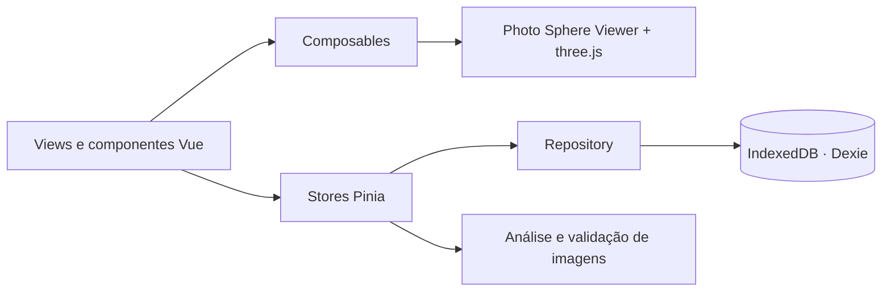

<div align="center">

# 🌐 Sphere 360

**Sua galeria de fotos 360° no navegador: importe, guarde e explore panoramas com toque, giroscópio ou óculos Cardboard.**

100% frontend · funciona offline · suas fotos nunca saem do seu dispositivo


[Recursos](#-recursos) · [Começando](#-começando) · [HTTPS e sensores](#-https-e-sensores-de-movimento) · [Cardboard](#-modo-vr-cardboard) · [Arquitetura](#-arquitetura) · [Contribuindo](#-contribuindo)

</div>

---

## ✨ Recursos

| | |
|---|---|
| 📥 **Importação inteligente** | Arraste e solte ou selecione vários arquivos JPEG, PNG ou WebP. Detecta o tipo real do arquivo, lê metadados **GPano (XMP)**, verifica a proporção 2:1 e ignora duplicatas pelo hash SHA-256. |
| 🖼️ **Galeria completa** | Busca, ordenação, grade ou lista, favoritos, álbuns, seleção múltipla e exclusão em lote. As miniaturas são carregadas sob demanda. |
| 🧭 **Visualizador imersivo** | Feito com [Photo Sphere Viewer](https://photo-sphere-viewer.js.org/): zoom, rotação automática, nivelamento do horizonte, tela cheia e navegação entre fotos com pré-carregamento. |
| 📱 **Giroscópio** | Olhe ao redor movendo o celular. A permissão de sensores do iOS 13+ é tratada corretamente. |
| 🥽 **Modo VR** | Visão estereoscópica para Google Cardboard, com guia de uso e tela sempre ligada. |
| 💾 **Armazenamento local** | Originais intactos no IndexedDB (via [Dexie](https://dexie.org/)), indicador de cota e pedido de armazenamento persistente. |
| 📦 **Backup** | Exporte e restaure toda a biblioteca em um único arquivo `.sphere360`. |
| 🌗 **Tema claro e escuro** | Respeita *safe areas* do iPhone, `prefers-reduced-motion` e navegação por teclado. |
| ⚡ **PWA** | Instalável e funciona offline depois do primeiro acesso. |

## 🚀 Começando

**Pré-requisitos:** [Node.js](https://nodejs.org/) 20 ou mais recente e npm.

```bash
git clone https://github.com/seu-usuario/sphere-360.git
cd sphere-360
npm install
npm run dev
```

Abra `http://localhost:5173` e arraste um panorama para a janela. 🎉

### Scripts

| Comando | O que faz |
|---|---|
| `npm run dev` | Servidor de desenvolvimento (HTTP, apenas localhost) |
| `npm run dev:https` | Servidor HTTPS na rede local, para testar no celular |
| `npm run build` | Checagem de tipos e build de produção em `dist/` |
| `npm run preview` | Serve o build de produção localmente |
| `npm run typecheck` | Checa os tipos com `vue-tsc` |
| `npm test` | Testes unitários (Vitest) |
| `npm run test:e2e` | Testes de ponta a ponta (Playwright) |
| `npm run fixtures` | Gera imagens de exemplo para os testes |

## 🔒 HTTPS e sensores de movimento

Navegadores só liberam giroscópio, tela cheia, *wake lock* e service worker em **contextos seguros**: `https://` ou `localhost`.

Por isso, ao abrir `http://192.168.x.x:5173` no celular, **o giroscópio e o modo VR não funcionam**. No iOS, o Safari nem chega a pedir a permissão.

A solução é usar o servidor HTTPS:

```bash
npm run dev:https
```

1. Abra no celular o endereço `https://<ip-do-computador>:5173` exibido no terminal.
2. Aceite o aviso do certificado autoassinado ("Avançado → Continuar").
3. No iPhone, toque em **Giroscópio** e permita o acesso a "Movimento e Orientação".

> 💡 Em produção, qualquer hospedagem estática com HTTPS funciona: GitHub Pages, Netlify, Vercel, Cloudflare Pages…
## 🥽 Modo VR (Cardboard)

1. Abra um panorama no celular, via HTTPS.
2. Toque em **Entrar no VR** e siga o guia.
3. Gire o celular para a horizontal e encaixe-o no Cardboard.
4. Olhe ao redor. Para sair, toque no **✕** no topo da tela ou pressione **Esc**.

O modo VR depende do giroscópio. Se o aparelho não tiver o sensor, o app avisa, e você continua explorando com o dedo ou o mouse.

## 📲 Instalando como app

- **Android / Chrome / Edge:** em **Ajustes → Instalar aplicativo**, ou pelo menu do navegador → "Instalar app".
- **iPhone / iPad:** no Safari, toque em **Compartilhar → Adicionar à Tela de Início**.

Instalar o app também ajuda a proteger seus dados: o Safari pode apagar dados de sites não instalados após 7 dias sem uso.

## ⌨️ Atalhos do visualizador

| Tecla | Ação |
|---|---|
| `Shift` + `←` / `→`, `PageUp` / `PageDown`, `P` / `N` | Foto anterior / próxima |
| Setas | Girar a câmera |
| `Espaço` | Liga/desliga a rotação automática |
| `R` | Reseta a câmera |
| `F` | Tela cheia |
| `I` | Painel de informações |
| `H` | Ocultar/mostrar controles |
| `Esc` | Sai do VR, fecha o painel ou volta para a galeria |

## 🏗️ Arquitetura



```text
src/
├── components/   # common, gallery, layout, viewer, vr
├── composables/  # usePanoramaViewer, useGyroscope, useWakeLock, ...
├── services/
│   ├── database/ # schema Dexie e repositório transacional
│   ├── images/   # detecção de tipo, XMP GPano, miniaturas, hash
│   └── storage/  # backup, preferências, erros de cota
├── stores/       # library, preferences, toasts, ui
├── views/        # Galeria, Visualizador, Álbuns, Ajustes
└── styles/       # Tailwind v4
```

**Banco de dados:** cada foto é dividida em três tabelas: `photos` (metadados), `originals` (o arquivo original, sem alterações) e `thumbnails` (WebP de 640 px). Assim, a galeria carrega rápido sem tocar nos arquivos grandes.

## ⚠️ Limitações

- Os dados ficam **apenas no navegador e no dispositivo**: não há sincronização. Limpar os dados do site apaga a biblioteca, então use o backup.
- Panoramas muito grandes são reduzidos **só na exibição**, para caber no limite de textura da GPU do aparelho. O original é preservado.
- Imagens HEIC e projeções que não sejam equirretangulares não são suportadas.
- Navegação privada costuma ter cota de armazenamento bem pequena.

## 🧪 Checklist de teste em dispositivos

- [ ] Importar várias fotos, inclusive uma duplicada e uma que não seja panorama
- [ ] Favoritar, renomear, criar álbum e excluir
- [ ] Recarregar a página e confirmar que tudo persistiu
- [ ] **iOS Safari (HTTPS):** pedido de permissão do giroscópio aparece e funciona
- [ ] **Android Chrome:** giroscópio e modo VR com tela sempre ligada
- [ ] Rotação retrato ↔ paisagem e *notch* do iPhone
- [ ] Instalar o PWA e abrir em modo avião
- [ ] Exportar backup, limpar os dados do site e restaurar

## 🤝 Contribuindo

Contribuições são muito bem-vindas! 💙

1. Faça um fork do repositório e crie uma branch: `git checkout -b feat/minha-ideia`.
2. Garanta que `npm run typecheck` e `npm test` passam.
3. Use [Conventional Commits](https://www.conventionalcommits.org/pt-br/), por exemplo `feat: adiciona filtro por data`.
4. Abra um Pull Request descrevendo a mudança. Prints e GIFs ajudam bastante!

Achou um bug ou tem uma sugestão? Abra uma [issue](../../issues).

## 🙏 Agradecimentos

- [Photo Sphere Viewer](https://photo-sphere-viewer.js.org/) e [three.js](https://threejs.org/), o coração do visualizador
- [Dexie.js](https://dexie.org/), IndexedDB sem dor de cabeça
- [Lucide](https://lucide.dev/), pelos ícones
- [Vite PWA](https://vite-pwa-org.netlify.app/)

## 📄 Licença

Distribuído sob a licença MIT. Veja [`LICENSE`](LICENSE).

<div align="center">

Feito com ☕ e muitas fotos 360°

</div>
